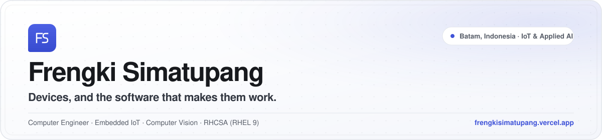

  <a href="https://frengkisimatupang.vercel.app">
    <picture>
      <source media="(prefers-color-scheme: dark)" srcset="./img/banner-dark.svg" />
      <source media="(prefers-color-scheme: light)" srcset="./img/banner-light.svg" />
      
    </picture>
  </a>

  
  
  
  

---

### About

I build at the intersection of **IoT, computer vision, and applied AI / machine learning**.

My background in precision manufacturing QA and QC shapes how I look at engineering: pay attention to measurements, investigate what went wrong, and keep the limits of a result visible. Today, I focus on how software and vision models behave inside real hardware.

- **Education:** Bachelor of Computer Engineering, Institut Teknologi Batam (ITEBA) — final thesis defense passed on 31 August 2026 (graduation ceremony pending), GPA `3.74 / 4.00`
- **Certification:** [Red Hat Certified System Administrator (RHCSA)](https://rhtapps.redhat.com/verify?certId=240-242-487) — RHEL 9 · Credential ID `240-242-487` · Current until `12 December 2027`
- **Location:** Batam, Riau Islands, Indonesia

---

### Selected Work

| Project | Role & Focus | Key Engineering Evidence | Links |
| :--- | :--- | :--- | :--- |
| **PANDU** *(Perangkat Asisten Navigasi dan Ucap)* | Hardware design & assembly, Money-model dataset & fine-tuning, evaluation | XIAO ESP32-S3 Sense smart-glasses prototype with shared OV2640 camera, WebSocket object-detection haptics, and HTTP Rupiah classification (YOLOv11n: `99.62%` Top-1 on 264 validation images; `192` correct / `16` rejected / `2` incorrect across 210 device trials; `SUS 78`). | [Case Study](https://frengkisimatupang.vercel.app/work/pandu) |
| **Hexapod Fire Suppression Robot** | Project Manager | Six-legged firefighting robot (18 leg servos, ultrasonic & flame sensors, pump) with sinusoidal tripod gait and separate logic vs. actuator supply paths examined across 4 load conditions (`4.99–5.01 V` logic vs. `5.45–6.02 V` actuator). | [Case Study](https://frengkisimatupang.vercel.app/work/hexapod) · [Repository](https://github.com/FrengkiSimatupang17/Hexapod_Fire_Suppression_with_Tripod_Gait) |
| **Phishing Email Analyzer** | Developer | Exploratory Python / Streamlit tool that parses email headers and explains rule-based phishing indicators, reported authentication status, and domain/IP patterns. | [Repository](https://github.com/FrengkiSimatupang17/Phishing_Email_Analyzer) |
| **Filltech ISP & Wi-Fi Management** | Backend Developer Intern *(Sep–Dec 2025)* | Backend contribution for an internal ISP and Wi-Fi management platform using Laravel and MySQL inside a React / Inertia application (schemas, recurring billing, vouchers, RBAC). | [Repository](https://github.com/FrengkiSimatupang17/Filltech-Project) |

---

### Technical Focus

| Domain | Stack & Tools |
| :--- | :--- |
| **Embedded & IoT** | ESP32-S3 Sense, Arduino, C/C++, FreeRTOS, LittleFS, OV2640, I2S audio (MAX98357A), PWM haptics, Fusion 360, PETG 3D printing |
| **AI & Computer Vision** | Python, PyTorch, Ultralytics YOLO11, OpenCV, transfer learning, image classification, dataset curation, confidence-based rejection |
| **Backend & Infrastructure** | FastAPI, PHP / Laravel, REST APIs, WebSocket, MQTT, AWS EC2 (CUDA), SQLite, MySQL, RHEL 9, LVM, `systemd`, SELinux, Git |
| **Quality Engineering** | GD&T, dimensional & optical inspection, calipers, micrometers, surface roughness testing, profile projectors, FQC/IPQC, root-cause analysis |

---

### Experience Snapshot

- **Backend Developer Intern** — PT. Filltech Berkah Bersama, Batam *(Sep–Dec 2025)*
- **QC Inspector** — PT. ENNOVI Precision Machining Batam *(2020–2025)*
- **QA Technician** — PT. NOK Freudenberg Batam *(2018–2020)*

---

### GitHub Activity

  <picture>
    <source media="(prefers-color-scheme: dark)" srcset="https://github-readme-stats.vercel.app/api?username=FrengkiSimatupang17&show_icons=true&bg_color=17191D&title_color=C9D3FF&text_color=F7F8FA&icon_color=4054D8&border_color=2B303B&count_private=true" />
    <source media="(prefers-color-scheme: light)" srcset="https://github-readme-stats.vercel.app/api?username=FrengkiSimatupang17&show_icons=true&bg_color=FFFFFF&title_color=17191D&text_color=575D68&icon_color=4054D8&border_color=E2E5EB&count_private=true" />
    
  </picture>
  <picture>
    <source media="(prefers-color-scheme: dark)" srcset="https://github-readme-stats.vercel.app/api/top-langs/?username=FrengkiSimatupang17&layout=compact&bg_color=17191D&title_color=C9D3FF&text_color=F7F8FA&border_color=2B303B" />
    <source media="(prefers-color-scheme: light)" srcset="https://github-readme-stats.vercel.app/api/top-langs/?username=FrengkiSimatupang17&layout=compact&bg_color=FFFFFF&title_color=17191D&text_color=575D68&border_color=E2E5EB" />
    
  </picture>

  <picture>
    <source media="(prefers-color-scheme: dark)" srcset="https://raw.githubusercontent.com/FrengkiSimatupang17/FrengkiSimatupang17/output/github-contribution-grid-snake-dark.svg" />
    <source media="(prefers-color-scheme: light)" srcset="https://raw.githubusercontent.com/FrengkiSimatupang17/FrengkiSimatupang17/output/github-contribution-grid-snake.svg" />
    
  </picture>

---

  <strong>Let’s talk about what you’re building.</strong> 
  <a href="mailto:frengkihotsabarsimatupang1@gmail.com">frengkihotsabarsimatupang1@gmail.com</a> ·
  <a href="https://frengkisimatupang.vercel.app">Portfolio</a> ·
  <a href="https://www.linkedin.com/in/frengki-hotsabar-parmonangan-simatupang-02992a32b/">LinkedIn</a>

